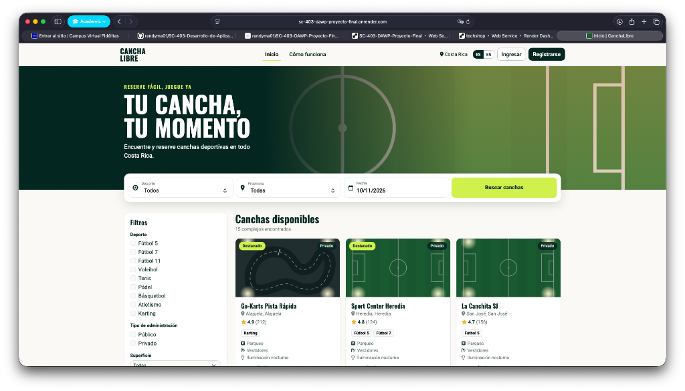
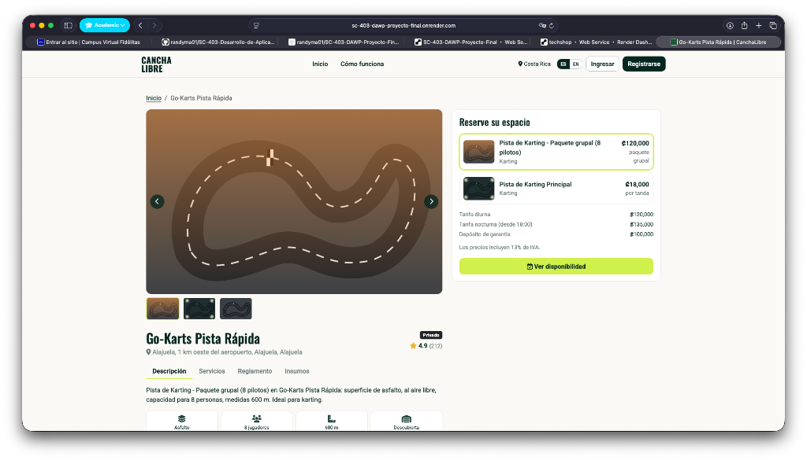
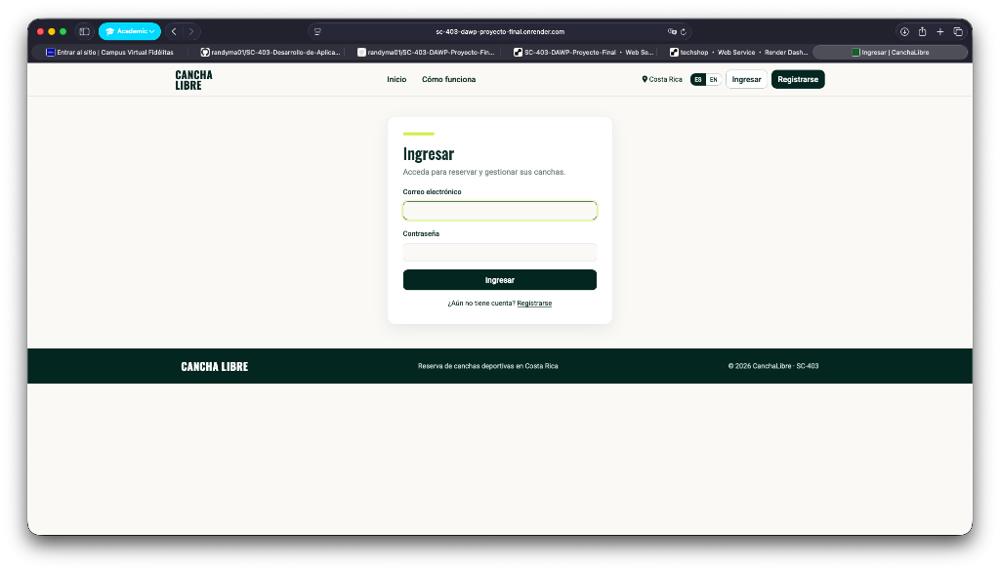
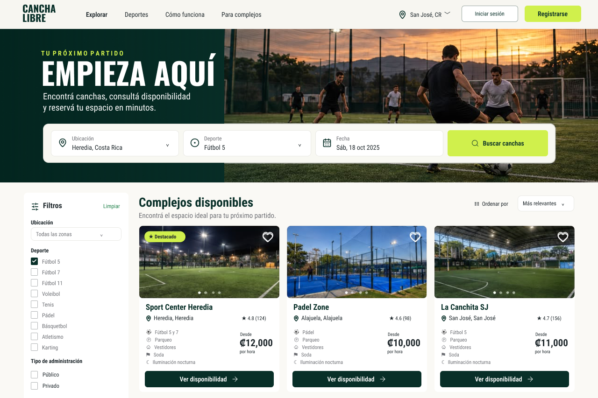
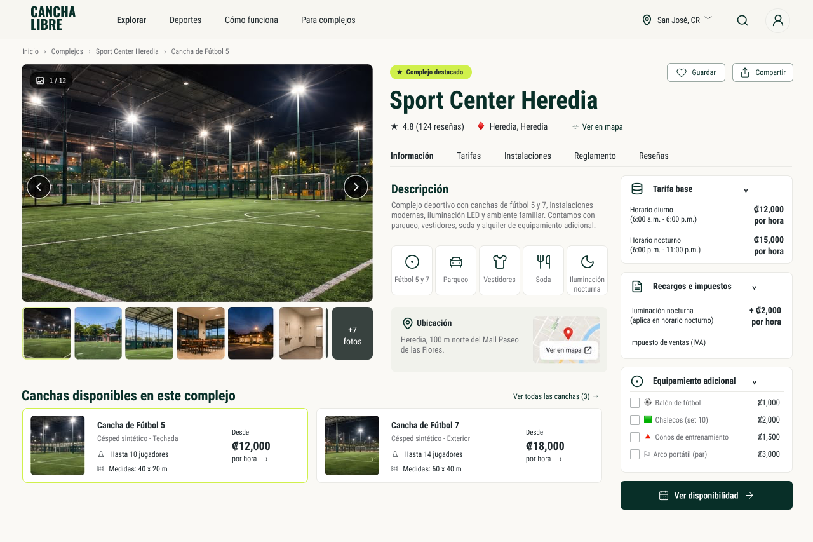
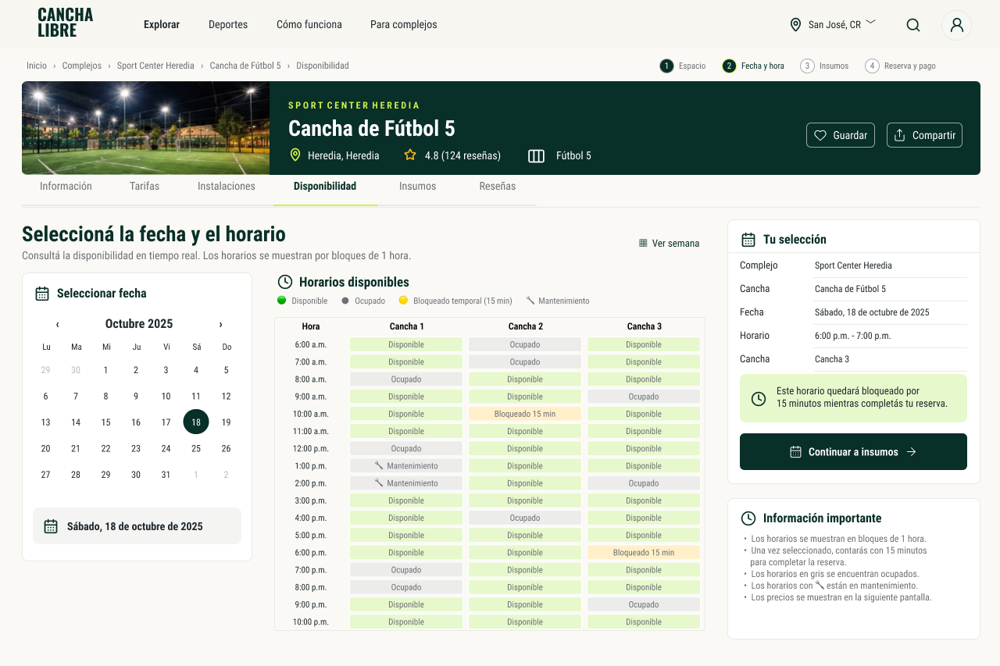
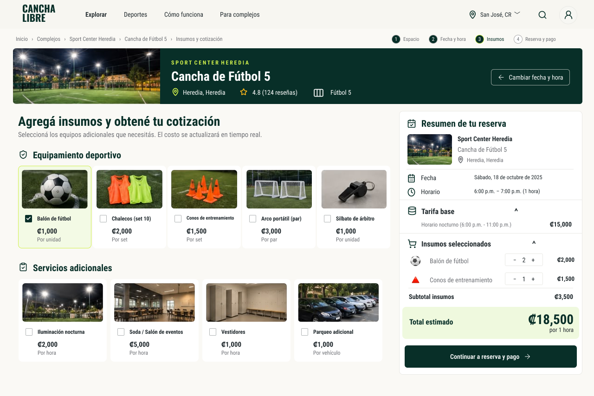
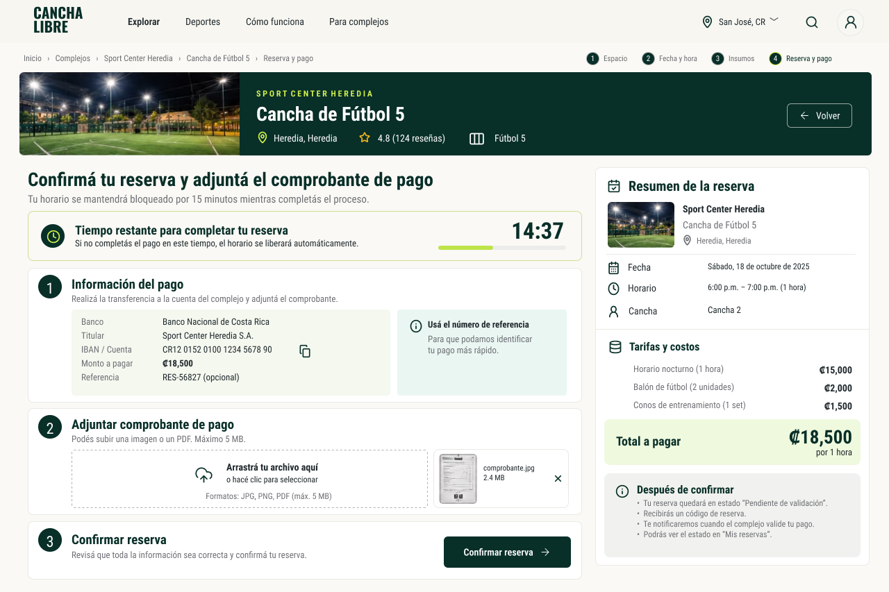
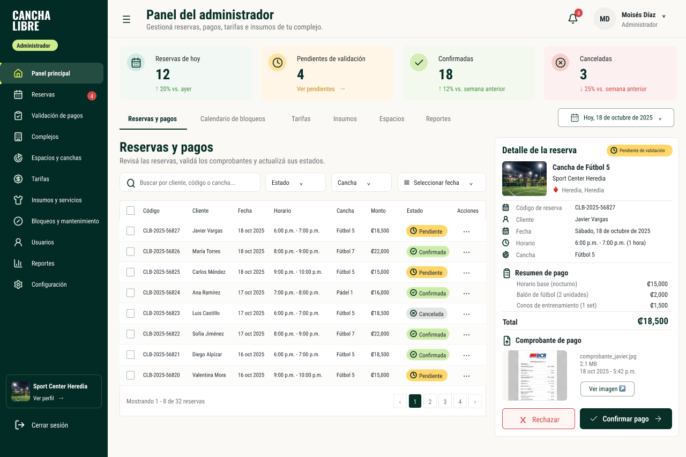
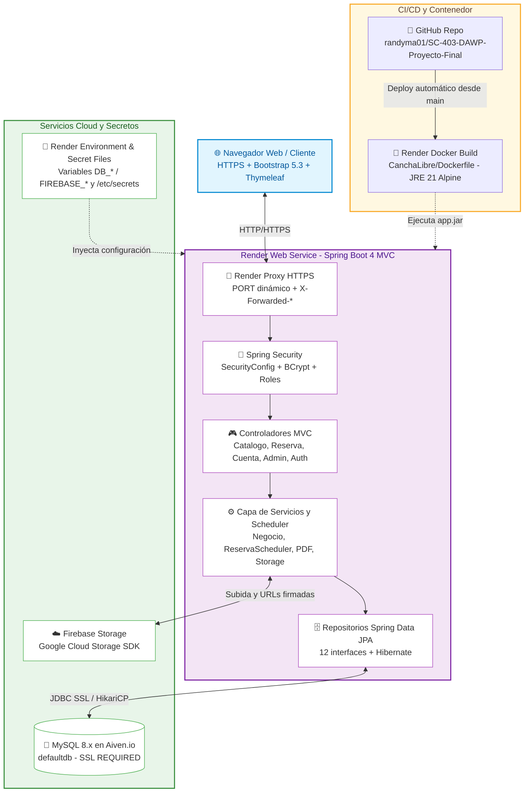

# ⚽ CanchaLibre

> **Plataforma Web Transaccional para la Gestión y Reserva de Espacios Deportivos**  
> Proyecto final para el curso **[SC-403] Desarrollo de Aplicaciones Web y Patrones (DAWP)** — Universidad Fidélitas.

[](https://sc-403-dawp-proyecto-final.onrender.com)
[](https://github.com/randyma01/SC-403-DAWP-Proyecto-Final)
[](https://aiven.io)
[](https://www.figma.com/design/0ImmhwST9yGAwPojsJ69CA/-Design----SC-403---Proyecto-Final?node-id=0-1&t=5YaBE4hTMfCqLvTM-1)

🌐 **Aplicación en vivo (Render):** [https://sc-403-dawp-proyecto-final.onrender.com](https://sc-403-dawp-proyecto-final.onrender.com)  
📦 **Repositorio oficial (GitHub):** [https://github.com/randyma01/SC-403-DAWP-Proyecto-Final](https://github.com/randyma01/SC-403-DAWP-Proyecto-Final)

---

## 📌 Tabla de Contenidos
1. [Descripción del Proyecto](#-descripción-del-proyecto)
2. [Despliegue en Producción y Evidencia](#-despliegue-en-producción-y-evidencia)
3. [Integrantes del Equipo](#-integrantes-del-equipo-grupo-16)
4. [Características Principales](#-características-principales)
5. [Diseño y Prototipos UI](#-diseño-y-prototipos-ui)
6. [Arquitectura del Sistema](#-arquitectura-del-sistema)
7. [Stack Tecnológico](#-stack-tecnológico)
8. [Estructura del Repositorio](#-estructura-del-repositorio)
9. [Requisitos Previos](#-requisitos-previos)
10. [Instalación y Puesta en Marcha](#-instalación-y-puesta-en-marcha)
11. [Configuración, Secretos y Despliegue en Render](#-configuración-secretos-y-despliegue-en-render)
12. [Documentación y Entregables](#-documentación-y-entregables)
13. [Flujo de Trabajo y Colaboración](#-flujo-de-trabajo-y-colaboración)
14. [Licencia y Contexto Académico](#-licencia-y-contexto-académico)

---

## 📖 Descripción del Proyecto

**CanchaLibre** es una solución web integral diseñada para digitalizar, optimizar y automatizar el ciclo de reserva de canchas y complejos deportivos. Resuelve la problemática habitual de la gestión manual (disponibilidad conflictiva, comprobantes dispersos y falta de control tarifario) mediante un flujo transaccional seguro:

* Permite a los **usuarios deportistas** (`ROLE_USER`) explorar espacios disponibles, verificar especificaciones técnicas, seleccionar insumos/equipamiento y reservar franjas horarias con cálculo tarifario diurno/nocturno y comprobante PDF descargable.
* Proporciona a los **administradores de complejos** (`ROLE_ADMIN`) un panel de control para gestionar espacios, tarifas, bloqueos e insumos, validar comprobantes de pago y supervisar reservas en tiempo real.

---

## 🌐 Despliegue en Producción y Evidencia

El sistema se encuentra desplegado en **Render** conectado directamente al repositorio de **GitHub** mediante un contenedor **Docker** multi-etapa ([`CanchaLibre/Dockerfile`](CanchaLibre/Dockerfile)), consumiendo una base de datos **MySQL** gestionada en **Aiven.io** (`sslMode=REQUIRED`) y almacenamiento de archivos en **Google Firebase Storage**.

* **URL de la aplicación desplegada:** [https://sc-403-dawp-proyecto-final.onrender.com](https://sc-403-dawp-proyecto-final.onrender.com)
* **Base de datos en la nube:** MySQL en [Aiven.io](https://aiven.io) (`defaultdb`, esquema administrado por [`data/01_schema.sql`](data/01_schema.sql))
* **Repositorio conectado:** [randyma01/SC-403-DAWP-Proyecto-Final](https://github.com/randyma01/SC-403-DAWP-Proyecto-Final)

### Evidencia de la Aplicación en Vivo (Render)

| Vista | Captura en Producción (`sc-403-dawp-proyecto-final.onrender.com`) |
| :--- | :---: |
| **Inicio y Catálogo de Complejos**<br/>Exploración pública de los 15 complejos cargados en Aiven MySQL con filtros por deporte, provincia, administración, superficie y fecha. |  |
| **Detalle de Complejo y Tarifas**<br/>Galería del complejo, ficha técnica, selección de espacio, tarifas diurna/nocturna, depósito de garantía y acceso a disponibilidad. |  |
| **Inicio de Sesión (`Spring Security`)**<br/>Autenticación de deportistas y administradores con redirección por rol hacia catálogo o panel administrativo. |  |

---

## 👥 Integrantes del Equipo (Grupo 16)

| Nombre Completo | Rol / Participación |
| :--- | :--- |
| **Díaz Darcia Moisés Gerardo** | Desarrollo Web Full Stack & Persistencia |
| **Martínez Sandi Randy Alejandro** | Arquitectura Spring, Integración UI & Despliegue |
| **Monge Barrantes Isaac David** | Desarrollo Web Full Stack & Lógica de Negocio |

---

## 🚀 Características Principales

* **Catálogo Dinámico de Espacios**: Filtro avanzado por disciplina deportiva, provincia, fecha, tipo de administración, superficie y características adicionales.
* **Cálculo Transaccional de Tarifas**: Desglose automático de tarifa base diurna, recargo por iluminación nocturna, depósito de garantía e insumos complementarios.
* **Gestión de Reservas y Expiración Automática**: Retención temporal de bloques horarios y liberación automática de reservas pendientes vencidas mediante `ReservaScheduler`.
* **Módulo de Comprobantes de Pago y PDF**: Carga digital de referencias y comprobantes bancarios con validación administrativa (*Pendiente*, *Aprobada*, *Rechazada*) y emisión de comprobante PDF (`ComprobantePdfService`).
* **Seguridad Basada en Roles**: Protección de rutas `/admin/**`, `/reservar/**`, `/reservas/**`, `/mis-reservas/**` y `/cuenta/**` con Spring Security y contraseñas cifradas con BCrypt.
* **Internacionalización (i18n)**: Soporte multi-idioma (`es` / `en`) mediante `messages.properties` y `messages_en.properties`.
* **Diseño Responsivo**: Interfaz basada en Bootstrap 5.3 y Font Awesome 6.5 integrados vía WebJars.

---

## 🎨 Diseño y Prototipos UI

El diseño visual y la experiencia de usuario (UI/UX) fueron creados y maquetados en **Figma**, abarcando las 7 vistas del ciclo transaccional:

🔗 **[Abrir Prototipo Interactivo en Figma](https://www.figma.com/design/0ImmhwST9yGAwPojsJ69CA/-Design----SC-403---Proyecto-Final?node-id=0-1&t=5YaBE4hTMfCqLvTM-1)** | 📁 **[Ver galería completa y especificaciones en `docs/design/`](docs/design/)**

| 1. Exploración de Complejos | 2. Detalle y Ficha Técnica |
| :---: | :---: |
|  |  |

| 3. Selección de Fecha y Franja Horaria | 4. Insumos y Desglose Tarifario |
| :---: | :---: |
|  |  |

| 5. Reserva y Carga de Comprobante | 6. Panel de Validación del Administrador |
| :---: | :---: |
|  |  |

> Consulta la pantalla de historial del usuario y detalles ampliados en la [galería completa de diseño](docs/design/README.md).

---

## 🏗 Arquitectura del Sistema

La aplicación sigue una arquitectura en capas basada en el patrón **MVC** sobre **Spring Boot 4**, empaquetada en un contenedor **Docker** desplegado automáticamente desde **GitHub** hacia **Render**, con persistencia en **MySQL (Aiven.io)** y almacenamiento de archivos en **Firebase Storage**:



> **Nota para pruebas automatizadas:** `mvn test` (`CanchalibreApplicationTests`) utiliza una base de datos en memoria **H2** (`MODE=MySQL`) y almacenamiento local temporal (`target/test-uploads`) configurados en [`CanchaLibre/src/test/resources/application.properties`](CanchaLibre/src/test/resources/application.properties), sin depender de Aiven ni Firebase.

---

## 💻 Stack Tecnológico

| Componente | Tecnología | Descripción |
| :--- | :--- | :--- |
| **Lenguaje** | Java 17 / 21 | Compilación con `release 17` y runtime JRE 21 en contenedor |
| **Framework** | Spring Boot 4.1.2 | Núcleo web MVC, validación, tareas programadas y configuración |
| **Seguridad** | Spring Security | Autenticación por formulario, BCrypt y control de acceso por roles |
| **Motor de Vistas** | Thymeleaf | Plantillas HTML del lado del servidor, fragmentos e i18n (`ES`/`EN`) |
| **Frontend / UI** | Bootstrap 5.3.3 + Font Awesome 6.5.2 | Integrados vía WebJars junto con jQuery y Popper.js |
| **Persistencia** | Spring Data JPA / Hibernate | Mapeo objeto-relacional y consultas transaccionales |
| **Base de Datos** | MySQL en Aiven.io (`SSL REQUIRED`) | Base de datos relacional alojada en la nube (`defaultdb`) |
| **BD de Pruebas** | H2 Database (scope `test`) | Base en memoria para pruebas aisladas sin conexión externa |
| **Almacenamiento** | Google Firebase Storage (`firebase-admin`) | Subida de imágenes y comprobantes (con fallback local `./uploads`) |
| **Contenedorización** | Docker (Multi-stage Alpine) | Construcción reproducible con Maven 3.9 + Eclipse Temurin 21 |
| **Despliegue Cloud** | Render | Web Service conectado al repositorio GitHub |

---

## 📁 Estructura del Repositorio

```text
SC-403-DAWP-Proyecto-Final/
├── CanchaLibre/                              # Proyecto Spring Boot Maven
│   ├── Dockerfile                            # Imagen multi-etapa para despliegue en Render
│   ├── .dockerignore                         # Exclusiones de build Docker (secretos y target/)
│   ├── pom.xml                               # Dependencias Maven y empaquetado target/app.jar
│   └── src/
│       ├── main/
│       │   ├── java/com/canchalibre/canchalibre/
│       │   │   ├── config/                   # i18n, recursos locales y mensajes
│       │   │   ├── controller/               # Controladores MVC (público, reserva, cuenta, admin)
│       │   │   ├── domain/                   # Entidades JPA y enums del dominio
│       │   │   ├── dto/                      # Formularios y objetos de vista/cotización
│       │   │   ├── repository/               # 12 repositorios Spring Data JPA
│       │   │   ├── security/                 # Configuración Spring Security y sesión
│       │   │   ├── service/                  # Lógica de negocio, PDF, Storage y Scheduler
│       │   │   ├── CanchalibreApplication.java
│       │   │   └── StorageConfig.java        # Cliente Google Cloud Storage (/etc/secrets o classpath)
│       │   └── resources/
│       │       ├── firebase/                 # Carpeta local para JSON Firebase (ignorado por Git)
│       │       ├── static/                   # CSS, JS e imágenes estáticas
│       │       ├── templates/                # Vistas Thymeleaf y secrets.properties.example
│       │       ├── application.properties    # Configuración general + spring.config.import
│       │       └── messages*.properties      # Textos internacionalizados (ES / EN)
│       └── test/
│           ├── java/                         # Pruebas automatizadas (@SpringBootTest)
│           └── resources/
│               └── application.properties    # Perfil aislado con H2 en memoria
├── data/                                     # Scripts SQL para MySQL / Aiven
│   ├── 01_schema.sql                         # Creación de las 13 tablas (compatible con Aiven)
│   ├── 02_seed.sql                           # Datos de prueba y usuarios demo
│   └── canchalibre.sql                       # Script consolidado
├── docs/                                     # Documentación y evidencia del proyecto
│   ├── design/                               # Prototipos visuales y especificaciones de Figma
│   ├── evidence/                             # Capturas reales de la app desplegada en Render
│   ├── instructions/                         # Enunciado y rúbricas del curso
│   └── work/                                 # Entregables del equipo (Avance 1, etc.)
├── .gitignore                                # Exclusiones globales (IDE, temporales y secretos)
└── README.md                                 # Documentación general del proyecto
```

---

## ⚙️ Requisitos Previos

Para ejecutar el proyecto localmente:
* **JDK 17** o superior instalado y configurado en el `PATH`.
* **Apache NetBeans IDE** (recomendado en el curso) u otro IDE compatible con Maven (IntelliJ IDEA, VS Code).
* Acceso a internet para descargar dependencias Maven y conectarse a **Aiven.io** / **Firebase** (o MySQL local si se trabaja sin Aiven).
* *(Opcional)* **Docker** si deseas construir/probar la imagen del contenedor en local.

---

## 🛠 Instalación y Puesta en Marcha

1. **Clonar el repositorio**:
   ```bash
   git clone https://github.com/randyma01/SC-403-DAWP-Proyecto-Final.git
   cd SC-403-DAWP-Proyecto-Final
   ```

2. **Configurar secretos locales** *(solo la primera vez)*:
   * Copia [`CanchaLibre/src/main/resources/templates/secrets.properties.example`](CanchaLibre/src/main/resources/templates/secrets.properties.example) como `CanchaLibre/secrets.properties` (ignorado automáticamente por Git).
   * Rellena `DB_URL`, `DB_USERNAME`, `DB_PASSWORD` (de Aiven o de tu MySQL local) y los datos de Firebase Storage (o `STORAGE_PROVIDER=local` para guardar en `./uploads`).
   * Si usás Firebase Storage en local, coloca el JSON de la cuenta de servicio dentro de `CanchaLibre/src/main/resources/firebase/`.

3. **Inicializar la base de datos** *(si usás una BD nueva o MySQL local)*:
   * Ejecutá [`data/01_schema.sql`](data/01_schema.sql) seguido de [`data/02_seed.sql`](data/02_seed.sql). *(La instancia compartida en Aiven ya cuenta con el esquema y los datos iniciales; en [`data/02_seed.sql`](data/02_seed.sql) están documentados los usuarios demo de prueba.)*

4. **Compilar y ejecutar en NetBeans (o terminal)**:
   * En **NetBeans**: *Archivo → Abrir Proyecto* → seleccionar `CanchaLibre` → **Clean and Build** (ejecuta pruebas con H2) → **Run**.
   * En **terminal**:
     ```bash
     cd CanchaLibre
     mvn clean install
     mvn spring-boot:run
     ```
   * Abre en el navegador `http://localhost:80` (o el puerto que definas en la variable `PORT`).

---

## 🔒 Configuración, Secretos y Despliegue en Render

Por seguridad, las credenciales privadas **nunca se versionan en GitHub** (`secrets.properties` y `**/firebase/*.json` están bloqueados en `.gitignore` y `.dockerignore`).

### Cómo funciona la configuración
* [`CanchaLibre/src/main/resources/application.properties`](CanchaLibre/src/main/resources/application.properties) importa `optional:file:./secrets.properties` en desarrollo local y lee variables de entorno del sistema en producción.
* [`StorageConfig.java`](CanchaLibre/src/main/java/com/canchalibre/canchalibre/StorageConfig.java) busca primero el JSON de Firebase en `/etc/secrets/<FIREBASE_JSON_FILE>` (ruta estándar de **Render Secret Files**) y, si no existe, en el `classpath`.
* El puerto de escucha usa `server.port=${PORT:80}` para adaptarse automáticamente al puerto asignado por Render.

### Parámetros de despliegue en Render (`Web Service`)
* **Repository:** `https://github.com/randyma01/SC-403-DAWP-Proyecto-Final`
* **Runtime:** `Docker`
* **Root Directory:** `CanchaLibre`
* **Environment Variables** (*Dashboard → Environment*):
  * `DB_URL` = `jdbc:mysql://<host>.aivencloud.com:<puerto>/defaultdb?sslMode=REQUIRED`
  * `DB_USERNAME` = `<usuario-aiven>`
  * `DB_PASSWORD` = `<password-aiven>`
  * `STORAGE_PROVIDER` = `firebase`
  * `FIREBASE_BUCKET_NAME` = `<proyecto>.firebasestorage.app`
  * `FIREBASE_STORAGE_PATH` = `cancha-libre`
  * `FIREBASE_JSON_PATH` = `firebase`
  * `FIREBASE_JSON_FILE` = `<nombre-archivo-service-account>.json`
* **Secret Files** (*Dashboard → Environment → Secret Files*):
  * Subir el JSON de credenciales de Firebase con el mismo nombre definido en `FIREBASE_JSON_FILE` (Render lo monta automáticamente en `/etc/secrets/`).

---

## 📚 Documentación y Entregables

Toda la evidencia y documentación se gestiona dentro de [`docs/`](docs/) y [`data/`](data/):
* **Avance 1**: Especificación de requisitos, historias de usuario y prototipos ([`docs/work/SC403_Avance-1_Grupo16.pdf`](docs/work/SC403_Avance-1_Grupo16.pdf)).
* **Diseño UI/UX (Figma)**: Galería de pantallas del flujo transaccional ([`docs/design/`](docs/design/)).
* **Evidencia de Despliegue (Render)**: Capturas reales en producción ([`docs/evidence/`](docs/evidence/)).
* **Scripts SQL (Aiven / MySQL)**: Esquema y datos semilla ([`data/`](data/)).
* **Enunciado del Proyecto**: Requerimientos técnicos y rúbrica evaluativa ([`docs/instructions/EnunciadoDelProyecto.pdf`](docs/instructions/EnunciadoDelProyecto.pdf)).

---

## 🌿 Flujo de Trabajo y Colaboración

* La rama `main` contiene únicamente código estable y probado, y alimenta el despliegue en Render.
* Cada integrante trabaja en ramas de características (`feat/<nombre-funcionalidad>`).
* La integración a `main` se realiza mediante **Pull Requests (PR)**.

---

## 📄 Licencia y Contexto Académico

Proyecto desarrollado con fines estrictamente académicos para la carrera de Ingeniería en Sistemas / Ciencias de la Computación en la **Universidad Fidélitas**, curso **SC-403**.  
Derechos reservados por los autores © 2026.
