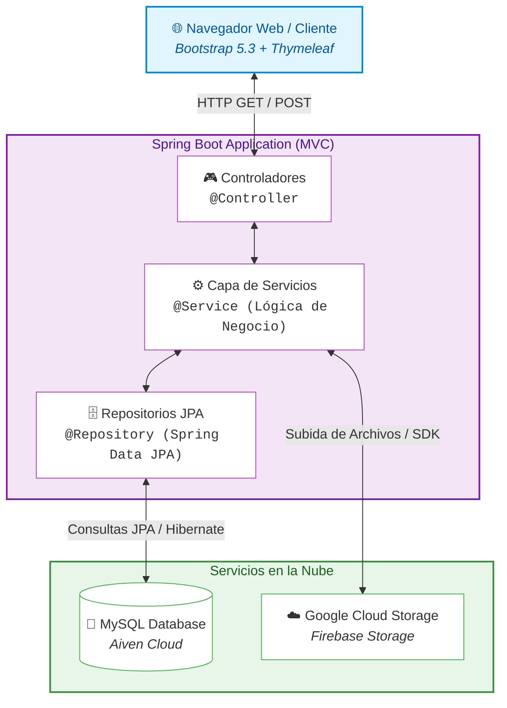

# ⚽ CanchaLibre

> **Plataforma Web Transaccional para la Gestión y Reserva de Espacios Deportivos**  
> Proyecto final para el curso **[SC-403] Desarrollo de Aplicaciones Web y Patrones (DAWP)** — Universidad Fidélitas.

---

## 📌 Tabla de Contenidos
1. [Descripción del Proyecto](#-descripción-del-proyecto)
2. [Integrantes del Equipo](#-integrantes-del-equipo)
3. [Características Principales](#-características-principales)
4. [Arquitectura del Sistema](#-arquitectura-del-sistema)
5. [Stack Tecnológico](#-stack-tecnológico)
6. [Estructura del Repositorio](#-estructura-del-repositorio)
7. [Requisitos Previos](#-requisitos-previos)
8. [Instalación y Puesta en Marcha](#-instalación-y-puesta-en-marcha)
9. [Configuración y Variables](#-configuración-y-variables)
10. [Documentación y Entregables](#-documentación-y-entregables)
11. [Flujo de Trabajo y Ramas](#-flujo-de-trabajo-y-ramas)
12. [Licencia y Contexto Académico](#-licencia-y-contexto-académico)

---

## 📖 Descripción del Proyecto

**CanchaLibre** es una solución web integral diseñada para digitalizar, optimizar y automatizar el ciclo de reserva de canchas y complejos deportivos. Resuelve la problemática habitual de la gestión manual (disponibilidad conflictiva, comprobantes dispersos y falta de control tarifario) mediante un flujo transaccional seguro:

* Permite a los **usuarios deportistas** explorar espacios disponibles, verificar especificaciones técnicas, seleccionar insumos/equipamiento y reservar franjas horarias con cálculo tarifario diurno/nocturno.
* Proporciona a los **administradores de complejos** un panel de control para gestionar espacios deportivos, validar comprobantes de pago y supervisar estados de asistencia en tiempo real.

---

## 👥 Integrantes del Equipo (Grupo 16)

| Nombre Completo | Rol / Participación |
| :--- | :--- |
| **Díaz Darcia Moisés Gerardo** | Desarrollo Web Full Stack & Persistencia |
| **Martínez Sandi Randy Alejandro** | Arquitectura Spring, Integración UI & Despliegue |
| **Monge Barrantes Isaac David** | Desarrollo Web Full Stack & Lógica de Negocio |

---

## 🚀 Características Principales

* **Catálogo Dinámico de Espacios**: Filtro avanzado por tipo de deporte, medidas, servicios adicionales y estado operativo.
* **Cálculo Transaccional de Tarifas**: Desglose automático de tarifa base, recargo por iluminación nocturna e insumos complementarios.
* **Gestión de Reservas en Tiempo Real**: Bloqueo temporal de horarios para evitar colisiones y doble reserva (*overbooking*).
* **Módulo de Comprobantes de Pago**: Carga digital de referencias bancarias con validación administrativa (*Pendiente*, *Aprobada*, *Rechazada*).
* **Internacionalización (i18n)**: Soporte multi-idioma mediante plantillas y archivos `messages.properties`.
* **Diseño Responsivo**: Experiencia fluida en dispositivos móviles y de escritorio mediante componentes Bootstrap estandarizados vía WebJars.

---

## 🏗 Arquitectura del Sistema

El proyecto sigue una arquitectura en capas basada en el patrón **MVC (Modelo-Vista-Controlador)**:



---

## 💻 Stack Tecnológico

| Componente | Tecnología | Descripción |
| :--- | :--- | :--- |
| **Lenguaje** | Java 17 / 21 | Lenguaje principal de backend |
| **Framework** | Spring Boot | Núcleo de la aplicación web transaccional |
| **Motor de Vistas** | Thymeleaf | Renderizado dinámico del lado del servidor y fragmentos |
| **Frontend / UI** | Bootstrap 5.3 + Font Awesome 6.5 | Integrados vía WebJars según la pauta del curso |
| **Persistencia** | Spring Data JPA / Hibernate | Mapeo objeto-relacional y consultas transaccionales |
| **Base de Datos** | MySQL 8.x / Aiven.io | Base de datos relacional alojada en la nube |
| **Almacenamiento** | Google Firebase Storage | Almacenamiento seguro de imágenes y comprobantes |
| **Gestor de Build** | Apache Maven | Gestión de dependencias y ciclo de vida de compilación |
| **Despliegue** | Render | Plataforma de alojamiento en la nube |

---

## 📁 Estructura del Repositorio

```text
SC-403-DAWP-Proyecto-Final/
├── CanchaLibre/                      # Proyecto Spring Boot Maven
│   ├── src/
│   │   ├── main/
│   │   │   ├── java/com/canchalibre/ # Código fuente (MVC)
│   │   │   └── resources/
│   │   │       ├── firebase/         # Credenciales de servicio (protegidas por .gitignore)
│   │   │       ├── static/           # Recursos estáticos (CSS, JS, imágenes locales)
│   │   │       ├── templates/        # Vistas y fragmentos Thymeleaf
│   │   │       └── application.properties # Configuración de la aplicación
│   │   └── test/                     # Pruebas unitarias y de integración
│   └── pom.xml                       # Descriptor de dependencias Maven
├── docs/                             # Documentación formal del curso
│   ├── instructions/                 # Enunciado y rúbricas de avances
│   └── work/                         # Entregables del equipo (Avance 1, etc.)
├── .gitignore                        # Exclusiones de Git (NetBeans, temporales y secretos)
└── README.md                         # Documentación general del proyecto
```

---

## ⚙️ Requisitos Previos

Antes de ejecutar el proyecto localmente, asegúrate de contar con:
* **JDK 17** o superior instalado y configurado en el `PATH`.
* **Apache NetBeans IDE** (recomendado para desarrollo) u otro IDE compatible con Maven (IntelliJ IDEA, VS Code, Eclipse).
* Conexión a internet (para la descarga inicial de dependencias Maven y acceso a servicios cloud).
* Servidor MySQL local (opcional si se utiliza la instancia remota en Aiven).

---

## 🛠 Instalación y Puesta en Marcha

1. **Clonar el repositorio**:
   ```bash
   git clone https://github.com/randyma01/SC-403-DAWP-Proyecto-Final.git
   cd SC-403-DAWP-Proyecto-Final
   ```

2. **Abrir en NetBeans**:
   * Archivo -> Abrir Proyecto -> Seleccionar la carpeta `CanchaLibre`.

3. **Compilación y dependencias**:
   * Haz clic derecho sobre el proyecto `CanchaLibre` y selecciona **Clean and Build** (*Limpiar y Construir*).

4. **Ejecución**:
   * Haz clic derecho sobre el proyecto y selecciona **Run**.
   * Abre tu navegador en: `http://localhost:80` (o el puerto configurado en `application.properties`).

---

## 🔒 Configuración y Variables de Entorno

Por motivos de seguridad, las credenciales privadas y claves de servicio **no se versionan** en el repositorio:
* **Base de datos (Aiven / Local)**: Configurar `spring.datasource.url`, `username` y `password` en el archivo local `application.properties`.
* **Firebase Storage**: El archivo JSON de credenciales de la cuenta de servicio debe ubicarse localmente en `CanchaLibre/src/main/resources/firebase/` y está excluido automáticamente por `.gitignore`.

---

## 📚 Documentación y Entregables

Toda la evidencia y documentación se gestiona dentro del directorio [`docs/`](docs/):
* **Avance 1**: Especificación de requisitos, 20+ historias de usuario y prototipos de interfaz ([`docs/work/SC403_Avance-1_Grupo16.pdf`](docs/work/SC403_Avance-1_Grupo16.pdf)).
* **Enunciado del Proyecto**: Requerimientos técnicos y rúbrica evaluativa ([`docs/instructions/EnunciadoDelProyecto.pdf`](docs/instructions/EnunciadoDelProyecto.pdf)).

---

## 🌿 Flujo de Trabajo y Colaboración

* La rama `main` contiene únicamente código estable y probado.
* Cada miembro del equipo trabaja mediante **ramas de características** (`feature/<nombre-funcionalidad>`).
* La integración a `main` se realiza mediante **Pull Requests (PR)** revisados.

---

## 📄 Licencia y Contexto Académico

Proyecto desarrollado con fines estrictamente académicos para la carrera de Ingeniería en Sistemas / Ciencias de la Computación en la **Universidad Fidélitas**, curso **SC-403**.  
Derechos reservados por los autores © 2026.
