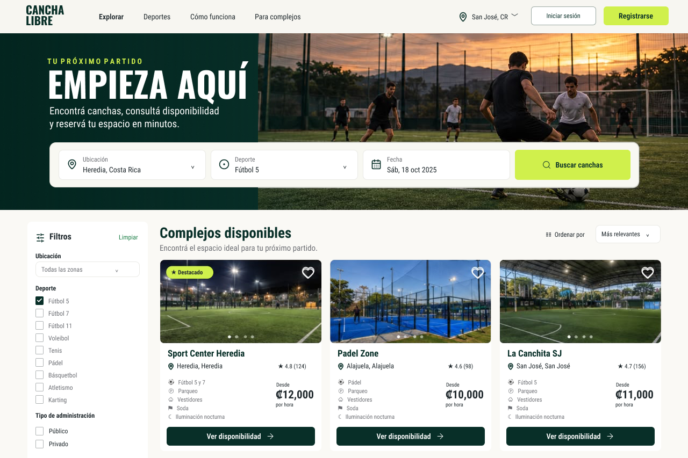
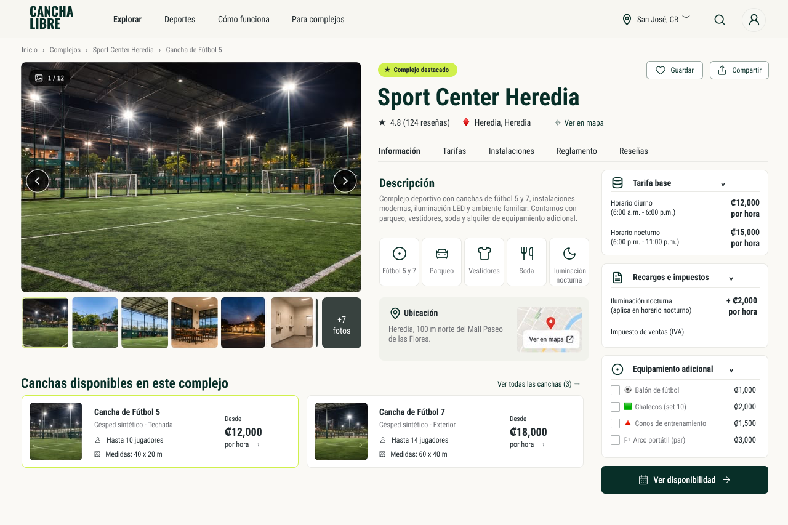
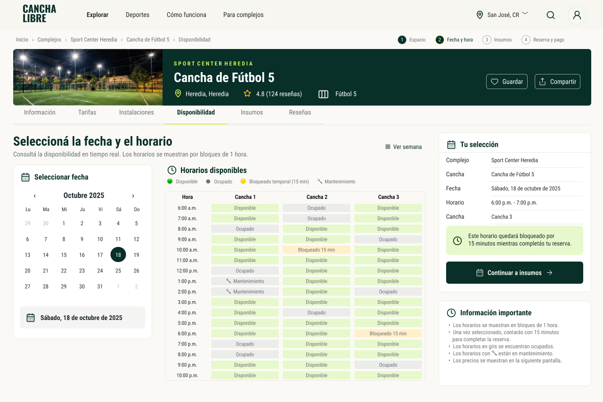
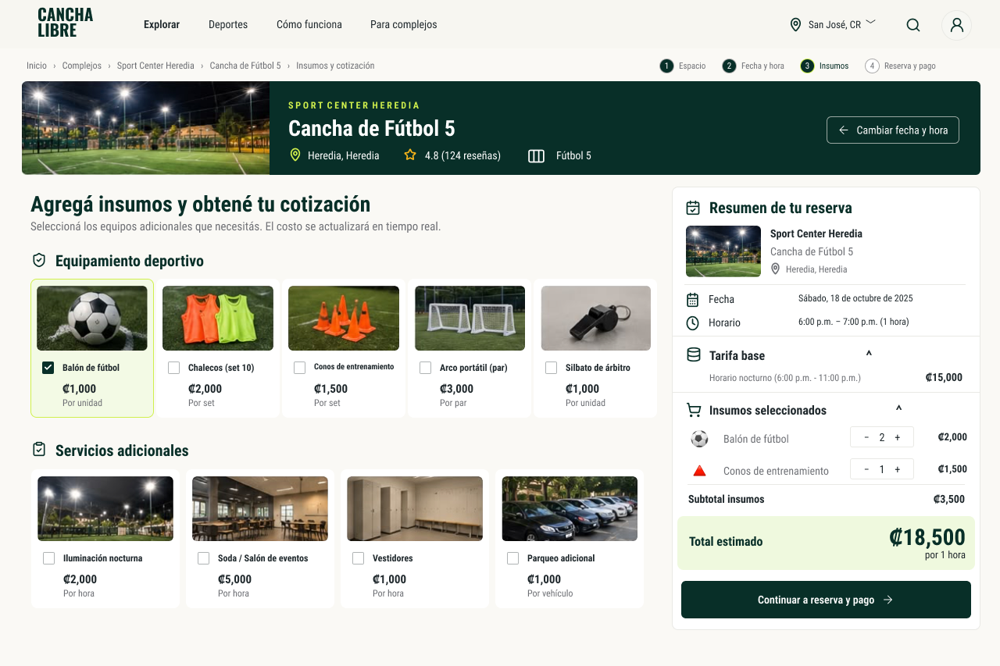
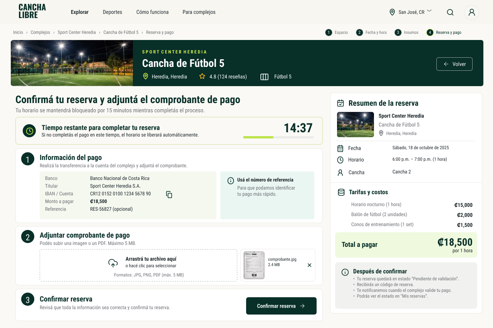
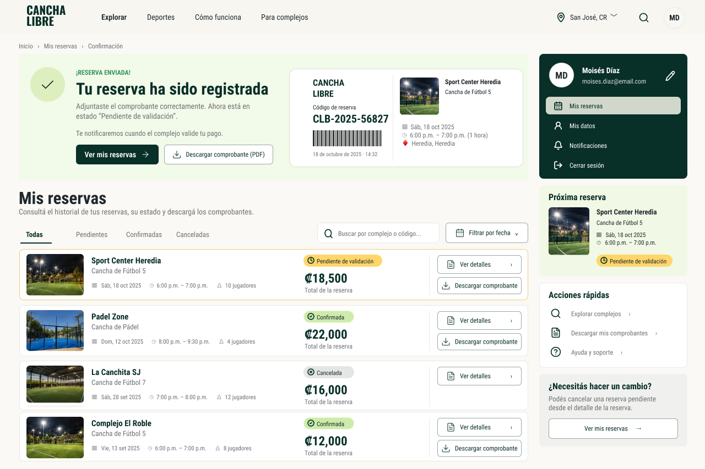
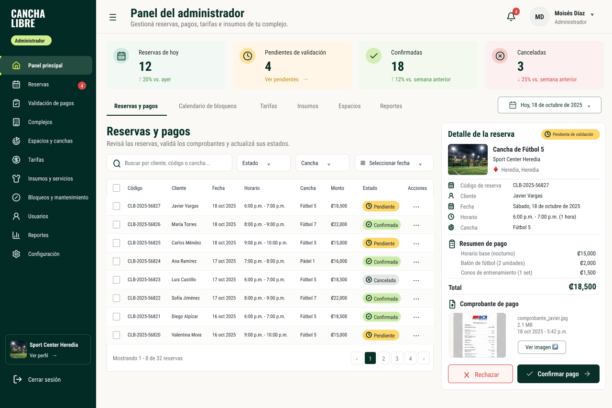

# 🎨 Prototipos de Diseño UI/UX - CanchaLibre

Este directorio contiene la evidencia visual del diseño de interfaces de usuario para la plataforma **CanchaLibre**, elaborados en **Figma** y alineados con las Historias de Usuario (HU) especificadas en el **Avance 1**.

🔗 **Enlace al archivo de diseño en Figma**:  
[**Abrir Proyecto en Figma**](https://www.figma.com/design/0ImmhwST9yGAwPojsJ69CA/-Design----SC-403---Proyecto-Final?node-id=0-1&t=5YaBE4hTMfCqLvTM-1)

---

## 📱 Pantallas del Sistema y Flujo Transaccional

### 1. Exploración y Catálogo de Complejos Deportivos
Búsqueda y filtrado de espacios deportivos por disciplina, ubicación, características y disponibilidad.

---

### 2. Detalle y Ficha del Complejo
Visualización de especificaciones técnicas: superficie, medidas, servicios básicos, reglas de uso y fotografías.

---

### 3. Disponibilidad, Selección de Fecha y Franja Horaria
Selector de fecha y cuadrícula de horarios en tiempo real con diferenciación de turnos diurnos y nocturnos.

---

### 4. Insumos Adicionales y Desglose Tarifario
Selección de implementos deportivos adicionales (balones, chalecos, cronómetros) con cálculo dinámico del costo.

---

### 5. Confirmación Transaccional y Carga de Comprobante
Resumen final del monto acordado, datos para transferencia bancaria y carga digital del comprobante de pago.

---

### 6. Historial Personal de Reservas (Vista Deportista)
Panel del usuario para consultar el estado de sus reservas pasadas y vigentes con badges interactivos (*Confirmada*, *Pendiente*, *Finalizada*).

---

### 7. Panel Administrativo de Validación (Vista Administrador)
Bandeja de entrada para que el encargado del complejo revise comprobantes adjuntos, apruebe o rechace reservas con justificación.

